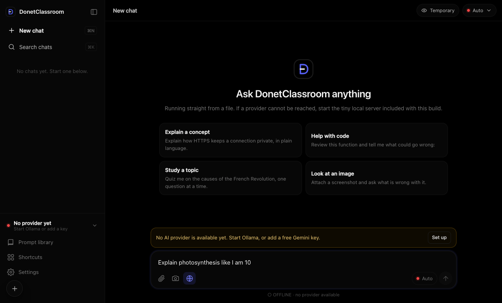

# DonetClassroom

**A fast, private, OLED-black AI assistant.** Runs on local [Ollama](https://ollama.com)
models, or free cloud models from Google Gemini and OpenRouter. $0 by default.



## Two ways to run it

| | How | Best for |
|---|---|---|
| **One file** | Double-click [`DonetClassroom-OneFile/DonetClassroom.html`](DonetClassroom-OneFile/DonetClassroom.html) | Trying it out, no install |
| **Server** | `cd DonetClassroom && npm install && npm start` → <http://localhost:5173> | Keeping API keys off the browser, sharing on your network |

Then pick a model source:
- **Local:** `brew install ollama && ollama pull qwen2.5:0.5b`, then start `ollama serve`.
- **Free cloud:** get a key at [aistudio.google.com/apikey](https://aistudio.google.com/apikey) and paste it
  in Settings → Cloud (one-file), or put `GEMINI_API_KEY=` in `DonetClassroom/.env` (server).

## Highlights

- Streaming chat with markdown, code highlighting, images and screenshots.
- **Web search** (🌐 button): searches Wikipedia with each message and cites the results.
- **Zero-cost protection:** paid models are blocked unless you explicitly allow them.
- Chat history, search, export/import, prompt library, quick-link shortcuts.
- Keyboard-first, accessible, and responsive down to phone size.

Full documentation: [`DonetClassroom/README.md`](DonetClassroom/README.md).

## Development

```bash
cd DonetClassroom
npm install
npm test                  # 11 offline tests
npm run build:onefile     # regenerate the one-file version after editing frontend/
```

MIT licensed.
